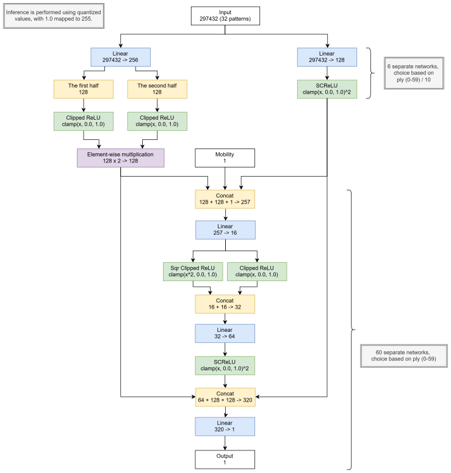
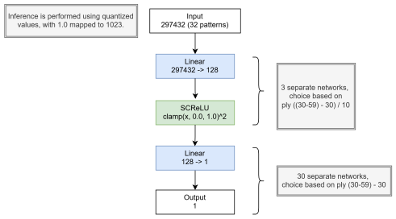

# Neural Reversi

[](https://github.com/natsutteatsuiyone/neural-reversi/actions/workflows/test.yml)
[](LICENSE)

This is an experimental project to develop a highly accurate neural network evaluation function for Reversi (Othello).

**[Play online (Lite version)](https://neural-reversi.net/)** ([source](https://github.com/natsutteatsuiyone/neural-reversi-wasm))

## Features

- Neural network-based position evaluation
- High-performance multi-threaded search
- Supports CLI and a native desktop GUI (NSH)

## Benchmarks (v6.3.0)

Full results, including other machines and the comparison with the previous
version: [docs/6.3.0/benchmarks.md](docs/6.3.0/benchmarks.md).

### Environment

- **CPU:** AMD Ryzen 9 9950X3D
- **Threads:** 32
- **Hash size:** 2048 MB
- **CPB (Core Performance Boost):** disabled unless noted

### Evaluation Accuracy

| Test | Problems | Depth | Time | Nodes | NPS | Best Move | Score ±3 | MAE |
|:--|:-:|:-:|--:|--:|--:|--:|--:|--:|
| [Hard-30](docs/6.3.0/benchmarks/hard-30-depth15.md) | 289 | 15 | 2.448s | 130,053,393 | 53,124,216 | 80.3% | 85.5% | 1.67 |

### Endgame Solving

| Test | Problems | Depth | Time | Nodes | NPS |
|:--|:-:|:-:|--:|--:|--:|
| [FFO #40–59](docs/6.3.0/benchmarks/fforum-40-59.md) | 20 | 20–34 | 6.029s | 12,791,069,853 | 2,121,636,861 |
| [FFO #40–59 (CPB Enabled)](docs/6.3.0/benchmarks/fforum-40-59.md) | 20 | 20–34 | 5.370s | 12,736,659,249 | 2,371,617,478 |
| [FFO #60–79](docs/6.3.0/benchmarks/fforum-60-79.md) | 20 | 24–36 | 184.418s | 334,416,880,379 | 1,813,367,928 |
| [FFO #60–79 (CPB Enabled)](docs/6.3.0/benchmarks/fforum-60-79.md) | 20 | 24–36 | 164.525s | 332,545,645,155 | 2,021,247,959 |
| [Hard-20](docs/6.3.0/benchmarks/hard-20.md) | 276 | 20 | 1.795s | 1,493,278,814 | 831,810,015 |
| [Hard-25](docs/6.3.0/benchmarks/hard-25.md) | 311 | 25 | 24.473s | 46,422,669,177 | 1,896,910,314 |
| [Hard-30](docs/6.3.0/benchmarks/hard-30.md) | 289 | 30 | 746.719s | 1,501,762,723,900 | 2,011,149,287 |
| [Small-35](docs/6.3.0/benchmarks/small-35.md) | 30 | 35 | 8,314.563s | 14,770,436,809,931 | 1,776,453,780 |

## Getting Started

### Prerequisites

- [Rust](https://www.rust-lang.org/tools/install)
- [cargo-make](https://github.com/sagiegurari/cargo-make) (recommended)
- Desktop GUI: native platform build tools and graphics drivers; see the [GUI prerequisites](crates/gui/README.md#prerequisites). Linux requires an X11 or Wayland session, GTK 4.14 or later, and GStreamer development/runtime libraries.

### Setup

1. Clone the repository:
   ```bash
   git clone https://github.com/natsutteatsuiyone/neural-reversi.git
   cd neural-reversi
   ```

2. Download the neural network weight files from the [weights releases](https://github.com/natsutteatsuiyone/neural-reversi-weights/releases)
   and place them in the project root directory. The build embeds the exact
   file names written in the source, which are not always in the latest release:
   - `eval-*.zst` and `eval_sm-*.zst`, named in `crates/eval-weights/src/lib.rs`

3. Run the interface you want to use:
   ```bash
   cargo run -p cli --release    # Play in the terminal (TUI)
   ```

   ```bash
   cargo run -p gui --release    # Launch the native NSH desktop application
   ```

### Large pages

Large pages can improve search performance by reducing memory-translation
overhead for the transposition table and other large buffers.

On Windows, follow Microsoft's [Lock pages in memory setup instructions](https://learn.microsoft.com/en-us/sql/database-engine/configure-windows/enable-the-lock-pages-in-memory-option-windows).
Without this privilege, the engine silently falls back to regular pages.

On Linux, Transparent Huge Pages are used automatically via `madvise`;
no setup or special privilege is needed, as long as the kernel's THP mode
allows `madvise` requests.

## Crates

- **[reversi-core](crates/reversi-core/)**: Core library implementing the AI search algorithms.
- **[cli](crates/cli/)**: Command-line interface for terminal play (TUI), GTP, GGS, FlipSight, and position solving.
- **[gui](crates/gui/)**: Native Rust graphical user interface built with NSH, calling `reversi-core` directly.
- **[match-runner](crates/match-runner/)**: Tool for automatically running matches between Reversi engines supporting the Go Text Protocol.
- **[datagen](crates/datagen/)**: Tool for generating neural network training data, including self-play games, shuffling/filtering, and ProbCut model fitting.
- **[search-test](crates/search-test/)**: Search test suite runner for benchmarking engine performance using OBF problem files (FFO Forum, Edax hard sets).

## Neural Network

### Architecture

#### Midgame



#### Endgame



### Features

- Mobility: The number of legal moves for the current player.
- Patterns:  
  

### Training

[neural-reversi-training](https://github.com/natsutteatsuiyone/neural-reversi-training)

## Build

Distribution builds are driven by [cargo-make](https://github.com/sagiegurari/cargo-make) and emit artifacts under `dist/`. The GUI is an ordinary Rust binary (`cargo build -p gui --release`): Windows/Linux distributions contain a native executable, while macOS packaging creates a `.app` and `.dmg` using Apple's command-line tools.

### Prerequisites

1. Install cargo-make:

   ```bash
   cargo install --force cargo-make
   ```

2. Download the neural network weight files from the [weights releases](https://github.com/natsutteatsuiyone/neural-reversi-weights/releases)
   and place them in the project root directory. The build embeds the exact
   file names written in the source, which are not always in the latest release:
   - `eval-*.zst` and `eval_sm-*.zst`, named in `crates/eval-weights/src/lib.rs`

### Distribution builds

Use one task for every binary, platform, and CPU tier:

```text
cargo make build-dist <cli|gui|all> <windows|linux|macos|all> <portable|native|x86-64-v2|x86-64-v3|x86-64-v4|apple-m1>
```

`native` optimizes for the build host. `portable` expands to `x86-64-v2`/`x86-64-v3`/`x86-64-v4` on Windows and Linux, and `apple-m1` on macOS. Choose a tier supported by the destination CPU; "portable" does not mean every CPU can run every tier. Build each GUI on its destination OS with its native toolchain; `all` does not install cross-compilers or platform SDKs. Builds are emitted under `dist/`; macOS packaging requires macOS and produces an ad-hoc signed, non-notarized `.app` and `.dmg`. See [GUI distribution and platform notes](crates/gui/README.md#distribution-and-platform-notes).

```bash
# Native CLI and GUI for Windows
cargo make build-dist all windows native

# All portable Windows CLI tiers
cargo make build-dist cli windows portable

# One AVX2-tier Linux GUI
cargo make build-dist gui linux x86-64-v3

# Apple Silicon CLI and GUI
cargo make build-dist all macos apple-m1
```

### Native GUI checks

```bash
cargo check -p gui --all-targets
cargo test -p gui --all-targets
cargo run -p gui --release
```

Tests cover the Rust application model and engine rather than a browser/WebDriver layer. Running the window requires a graphical desktop and a compatible GPU driver. See the [GUI README](crates/gui/README.md) for features, saved settings, and platform requirements.

## Verification

`verification/` holds two formal verification suites for `crates/reversi-core`. Both check hand-written models rather than the compiled Rust binary. Correspondence to `crates/reversi-core` rests on the Rust differential checks, mutant checks, engine unit tests, and source review.

- **[Lean 4 proofs](verification/lean/README.md)** (`verification/lean/`): Proves properties of core engine models, including board and flip logic, stability, evaluation, the transposition table, search, and threading. The runner audits every module and axiom, enforces proof-policy checks, and runs weight-free differential tests against `crates/reversi-core`. Requires [elan](https://github.com/leanprover/elan), Python 3.10 or later, and the Rust toolchain pinned in [`rust-toolchain.toml`](rust-toolchain.toml).
- **[TLA+ concurrency models](verification/tla/README.md)** (`verification/tla/`): Model-checks the concurrency protocols in `crates/reversi-core` (YBWC split points with panic unwinding, `ThreadPool` lifecycle and Lazy SMP <-> YBWC switching, `StopToken`/`AbortState` generation wrap, lock-free `TranspositionTable` SeqLock, and `ConcurrentMoveIterator`/`InFlightTable` postponement) with TLC, verifies that broken protocol mutants fail their expected properties, and includes Quint -> TLC -> Lean witness replays under [`verification/tla/lean-witnesses/`](verification/tla/lean-witnesses/README.md). Requires Java 11 or later and Python 3.10 or later.

Run either suite from the repository root with `cargo-make`, or run [`verification/lean/check.py`](verification/lean/check.py) and [`verification/tla/check.py`](verification/tla/check.py) directly:

```bash
cargo make verify-lean   # Run Lean proofs, audits, policy regressions, and Rust differential checks
cargo make verify-tla    # Run default, deep, and mutant TLC checks across all TLA+ models
```

GitHub Actions runs [`.github/workflows/verify-lean.yml`](.github/workflows/verify-lean.yml) and [`.github/workflows/verify-tla.yml`](.github/workflows/verify-tla.yml) on pushes and pull requests to `main` when `verification/` or covered `crates/reversi-core` files change.

## License

This project is licensed under the [GNU General Public License v3 (GPL v3)](LICENSE). By using or contributing to this project, you agree to comply with the terms of the license.

Neural Reversi includes code originally licensed under GPL v3 from the following projects:

- **[Edax](https://github.com/abulmo/edax-reversi)**
- **[Stockfish](https://github.com/official-stockfish/Stockfish)**
